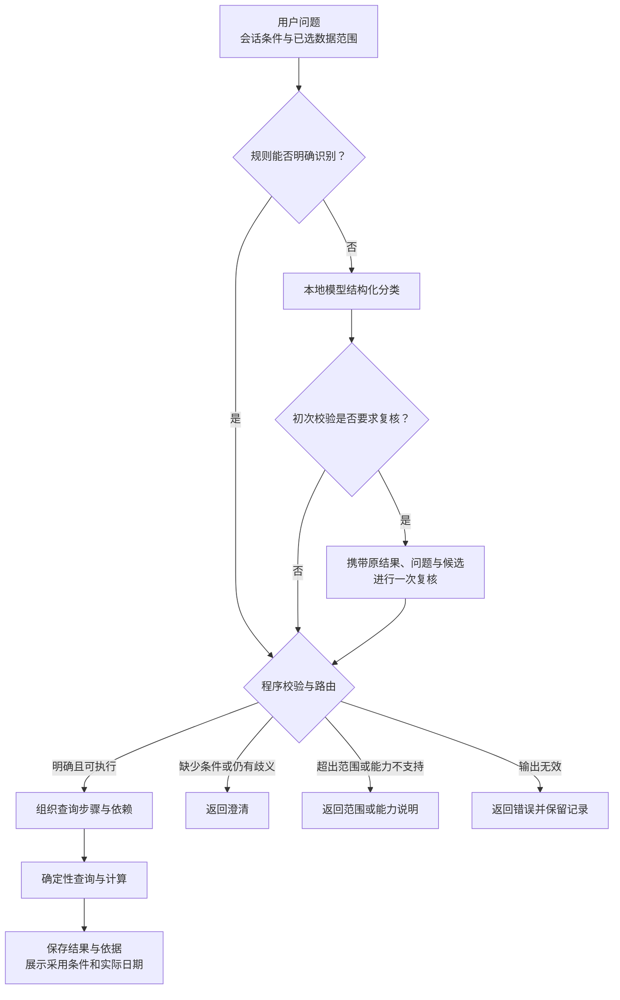
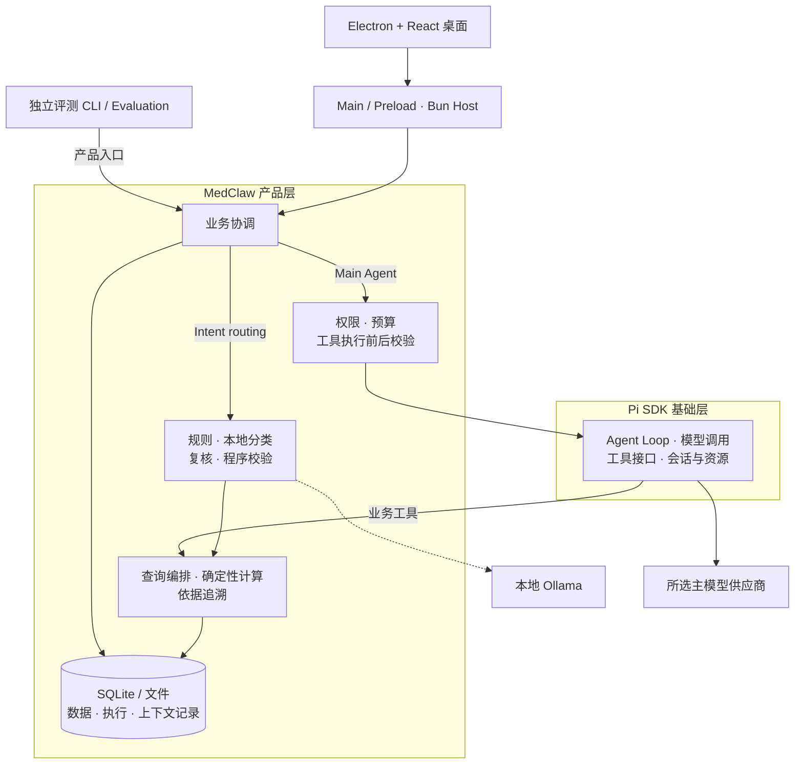

<h1 align="center">MedClaw</h1>

<p align="center">
  <strong>面向医疗器械数据的本地桌面问数工作台</strong><br />
  用分层意图识别理解问题，用确定性查询计算结果，用执行记录与独立评测核查过程。
</p>

<p align="center">
  <a href="LICENSE"></a>
  <a href="package.json"></a>
  <a href="package.json"></a>
  <a href="#quick-start"></a>
</p>

<p align="center">
  <a href="#highlights">项目亮点</a> ·
  <a href="#overview">使用场景</a> ·
  <a href="#intent">意图识别</a> ·
  <a href="#architecture">核心技术</a> ·
  <a href="#features">产品功能</a> ·
  <a href="#quick-start">快速开始</a> ·
  <a href="#development">开发入口</a> ·
  <a href="docs/README.md">双语文档</a> ·
  <a href="#boundaries">当前限制</a>
</p>

---

**MedClaw** 将结构化医疗器械数据、自然语言问数与 Agent 执行连接到同一个桌面工作台。导入数据快照后，可以筛选器械、统计数量、比较批次、查看价格趋势，并沿着查询条件、来源行与字段依据复核结果。

项目以**分层意图识别**作为问数入口：规则、本地小模型与程序校验协作，将问题组织为受支持的业务查询；需要使用主模型和工具时，由 **Pi SDK** 提供 Agent 运行基础，MedClaw 产品层负责权限、预算、执行校验、数据服务与记录交付。独立评测则从真实产品入口检查结果与过程。

<a id="highlights"></a>

## ✨ 项目亮点

| 核心能力 | MedClaw 的实现 | 实际价值 |
| --- | --- | --- |
| 🧠 **分层意图识别与路由** | 三级意图标签、规则优先、本地小模型结构化分类、按需复核与程序校验协作，结合实体、日期和会话条件组织查询。 | 将自然语言问题转成可检查的业务请求，及时澄清缺失条件与歧义。 |
| 📊 **确定性查询与依据追溯** | 自定义快照导入、查询编排、统计与差异计算，保存采用条件、实际日期、来源行和字段来源。 | 数量、金额与变化结果有明确计算口径，支持沿原查询核查。 |
| ⏱️ **预算感知的 Agent 控制** | 统一管理模型调用、工具尝试、失败恢复与剩余时间，向模型反馈资源状态，并为最终回答保留时间。 | 限制无效循环，使执行接近资源上限时能够收敛并说明未完成事项。 |
| 🛠️ **工具协议与延迟管理** | 在 Pi 工具接口之上增加权限、输入输出及业务结果校验，结合可比较的历史耗时和剩余预算约束超时。 | 工具能否调用、结果能否采用、执行何时结束都有独立检查。 |
| 🔎 **故障诊断与受限恢复** | 区分调用、执行、结果处理、持久化和交付失败，将修复动作关联原失败，优先读取已保存结果并限制重试。 | 提供可定位的失败原因，减少重复执行与对未知结果的误判。 |
| 🗂️ **可追溯的会话与上下文** | 基于 Pi 会话历史增加 SQLite 持久化、任务上下文选择、调用快照与交付记录。 | 连续追问可复用已有条件，也能核查一次调用实际采用了哪些材料。 |
| 🧪 **独立的 Agent 评测体系** | 分离 Case 定义、Trial 执行与评分，结合确定性检查和独立 Judge，核查最终结果、过程证据及安全约束。 | 将产品行为与模型回答一起评估，保留可复核的本地原件。 |
| 📈 **重复试验与反馈闭环** | 按 Case 统计成功率、pass@k、波动与执行缺口，保留失败和不可判定状态，支持报告比较、反馈与显式平台同步。 | 在相同条件下观察稳定性，为回归和问题修复提供依据。 |

<a id="overview"></a>

## 📌 项目概述与使用场景

MedClaw 面向已有结构化医疗器械数据的分析使用者、结果核查者和开发维护者，将“选数据 → 提问题 → 确认口径 → 查看结果 → 核查依据 → 继续追问或导出”放进同一条工作流。

| 场景 | 示例问题 | 关注点 |
| --- | --- | --- |
| 器械筛选 | “查看指定日期浙江地区在售的某类器械。” | 数据覆盖、器械范围与在售条件。 |
| 分组统计 | “按生产企业统计所选批次的器械数量。” | 统计对象、去重口径和分组条件。 |
| 批次比较 | “比较两个已导入日期的价格变化，列出价格上涨的器械。” | 对比日期、原值、现值和变化依据。 |
| 趋势与追问 | “查看这个器械的价格趋势，再把日期范围缩小到最近一周。” | 继承的对象、明确修改的条件和缺失日期。 |

示例用于说明使用意图，实际可执行范围由导入数据、已选择批次和当前业务能力共同决定。公开属性、模拟业务字段与推导字段分别保留来源说明。

<a id="intent"></a>

## 🧠 意图识别与查询执行

MedClaw 将问题理解拆成可校验的环节，执行路径为：

**用户问题 → 规则判断 → 本地模型分类 → 必要时复核 → 程序校验 → 查询组织与执行。**



1. **规则优先。** 对能够明确判断的请求直接生成结构化结果，完成校验后执行；规则未命中时才调用本地意图模型。
2. **分层分类。** 用三级标签表达业务领域、任务类型与具体动作，模型输出结构化意图、实体、时间、统计口径及必要参数。
3. **按需复核。** 当首次结果需要消歧或纠正时，携带原结果、校验问题和候选项进行一次复核；满足条件的结果直接进入后续处理。
4. **程序校验。** 检查层级关系、字段合法性、实体匹配、条件继承、日期与数据覆盖，以及该操作是否具备实际执行能力。
5. **组织查询。** 将通过校验的意图转换为业务查询步骤，处理受支持的多意图依赖与比较任务，再由程序完成计算、记录和交付。

例如，“比较两个日期之间某类器械的价格变化”需要明确对象、日期、比较口径与数据覆盖；“再只看在售的”则需要结合已有查询条件，保留用户新指定的限制。页面展示实际采用的条件与数据日期，方便继续纠正。

信息不足或存在未解决歧义时，系统返回澄清；超出领域或缺少已实现能力时，返回对应说明。**注册了意图标签并不表示该操作已经可执行**：证书查询、任意字段审计、正式监测报告等仍受当前数据和适配能力限制。自动导出意图也与页面中的原查询导出操作分别管理。

本地意图识别通过 Ollama 接入应用支持的本地轻量模型，与主 Agent 模型独立配置。意图路由默认关闭，启用方式见[快速开始](#quick-start)；识别效果仍有待完善，使用时应复核采用条件。

<a id="architecture"></a>

## ⚙️ 核心技术与工程实现

### 技术栈与整体架构

| 层次 | 技术 | 职责 |
| --- | --- | --- |
| 桌面界面 | Electron、React、TypeScript | 对话、数据工作区、查询依据、模型与评测操作。 |
| 应用与进程 | Bun workspaces、受控 Bun Host | 协调业务执行、停止、保存与维护。 |
| Agent 基础 | Pi SDK `0.87.1` | Agent Loop、模型调用、原生工具、会话历史与资源加载。 |
| 意图识别 | Ollama、本地轻量模型 | 本地结构化分类，配合自定义规则、校验与查询编排。 |
| 数据与存储 | 领域业务服务、`bun:sqlite`、本地文件 | 快照、统计、差异、依据、历史、导出与归档。 |
| 契约与验证 | Zod、Bun Test、Playwright Electron | 边界校验、工程测试及桌面交互检查。 |



Main 管理应用的 Host、凭据交接与独立评测进程，Host 承担业务数据写入。桌面 Evaluation 与评测 CLI 复用同一套评测执行设施，使用独立于聊天配置的 Agent / Judge 设置。

### Pi 与产品层的分工

| 模块 | 基础能力 | MedClaw 增加的工程实现 |
| --- | --- | --- |
| 工具执行 | Pi SDK 的工具接口、原生工具及调用生命周期。 | 作用域与权限约束、输入输出校验、业务前后置检查、预算与超时控制、执行记录和诊断。 |
| 会话管理 | Pi 的会话树、历史、分支与事件机制。 | 桌面会话操作、SQLite 持久化、运行状态同步、必要保存与结果交付。 |
| 上下文管理 | Pi 的消息、历史和运行时上下文接口。 | 按任务选择材料、约束作用域、记录调用快照，并关联查询依据。 |
| 模型接入 | Pi 的模型目录、Provider 与认证接口。 | 产品配置发布、凭据保护、默认及会话模型选择，以及独立的 Ollama 意图模型接入。 |
| 资源与扩展 | Pi 的资源加载与扩展机制。 | 资源登记、路径与依赖检查，以及受管扩展接入。 |
| 数据与评测 | 复用 Pi 的运行和模型调用接口。 | 领域数据导入、查询计算、依据追溯，以及独立执行、评分、统计和报告管理。 |

### 预算反馈与延迟控制

MedClaw 在模型调用前检查剩余调用次数、工具次数、执行时间与恢复额度，并将剩余资源、尚未解决的失败和收敛要求反馈给模型。接近上限时停止继续使用工具，为基于已有证据形成最终回答保留时间。

工具耗时按工具版本、SDK 版本、环境与工作负载分组统计。样本充分且超时比例满足条件时，使用历史 P95 耗时估算执行窗口；样本不足时采用配置值。实际超时同时受配置上限、原生工具参数和剩余预算约束。超时请求、实际停止与停止延迟分别记录，未确认完成的执行保留为未知状态。

### 工具执行的完整链路

以查询器械的 `query_current_devices` 为例：

1. **执行前检查：** 核对工具是否在当前作用域内、输入是否合法、任务是否仍有效，以及调用预算是否允许；原有扩展钩子修改参数后，还会再次检查。
2. **执行与记录：** 通过 Pi 工具接口调用业务服务，将本次调用与 Run、Session 和查询身份关联，在受控时间内执行确定性查询。
3. **结果校验：** 检查返回结构、可交付大小，以及业务结果与原请求的对象、日期、范围和统计口径是否一致。
4. **保存与交付：** 保存执行结果和校验状态，再记录 SDK 交付情况。若查询已保存而后续交付失败，可按原查询身份读取结果，保留失败环节与未解决事项。

原生文件与终端工具沿用 Pi 的底层实现，MedClaw 在调用边界施加执行约束；业务查询工具则由产品层提供领域逻辑。

### 故障诊断与受限恢复

失败记录包含发生环节、错误类型、校验问题与可读取的原始结果。恢复动作必须关联具体失败：输入纠正保留原对象和作用域，已保存查询优先读取原件，相关失败解除后才更新恢复状态。

恢复次数受到预算限制。执行副作用或保存结果无法确认时，系统保留未知状态并限制后续动作；无关工具调用成功不能将原失败标记为已修复。一次工具返回成功，也仍需通过结果校验和交付检查。

### 独立评测与稳定性分析

- **任务与结果分离：** Case 定义输入、初态、预期和判据；Trial 记录一次执行；轨迹、原始产物与评分结果分别保存，最终业务结果与执行过程分别检查。
- **确定性检查与独立 Judge：** 程序核对结构化事实、工具行为、证据和安全约束，独立配置的 Judge 处理适用的语义评分；每个适用 Trial 最多一次 Judge 请求，不自动重试。
- **重复试验：** 在相同执行条件下为同一 Case 运行多个 Trial，计算成功率、pass@k 和波动，保留原始分子、分母、单位与执行缺口。存在阻塞或无法判定的必要结果时，相关统计保留缺口。
- **反馈与回归：** 本地归档保存原始结果，可查看、比较并记录反馈；上传与反馈同步由用户显式发起，可接入 Langfuse。

评测数据按已登记材料与来源说明使用。已有工程检查验证设施行为，真实模型质量由实际试验结果支持。

<a id="features"></a>

## 🤔 产品功能

### 数据与问数

- **Data Workspace：** 选择快照目录、预览导入问题、确认导入并选择分析批次，浏览器械与变化记录。
- **查询与分析：** 支持器械过滤、分组统计、批次差异与价格趋势，结合自然语言识别结果或查询条件表单明确口径。
- **Query History：** 查看已保存条件、结果、数据日期和来源依据，将原查询结果导出为 CSV 目录包、JSON 或 Markdown。

### 会话与 Agent

- **多会话工作：** 创建、切换、改名与删除 Session，在各自历史中继续追问，保留草稿和当前数据选择。
- **上下文与历史：** 接入 Pi 会话树、历史恢复和压缩，结合产品层上下文快照与交付记录核查执行。
- **执行观察：** 查看工具调用和运行详情，分别确认停止、必要保存与资源释放的实际状态。

### 模型与扩展

- **Models：** 浏览模型目录，完成认证，登记自定义供应商与模型，设置默认模型或为当前 Session 选择模型。
- **Intent model：** 独立配置和核验本地意图模型，启用后在 Chat 中选择意图路由。
- **Prompt / Skills / Extensions：** 管理任务资源与受信扩展。

### 评测与维护

- **Evaluation：** 预检、运行、取消和查看进度，浏览报告、证据与比较结果，记录反馈并显式上传或同步。
- **Settings：** 提供 Host 控制、诊断、备份与独立数据根恢复。
- **Windows 打包：** 提供 Windows x64 NSIS 构建入口，安装后的实际体验仍需独立验证。

<a id="quick-start"></a>

## 🚀 快速开始

### 1. 准备环境并启动

开发环境使用 **Windows x64、Bun `1.4.0`、Node.js 24**。首次启动会准备运行资源与随包工具，需要访问相关下载源；业务数据和模型服务分别准备。

> **当前安装前置：** `package.json` 与锁文件声明的一项依赖补丁文件未随仓库提供。干净检出需先由维护者补齐缺失补丁，才能验证依赖安装与完整构建。

补齐前置后，在项目根目录运行：

```powershell
bun install --frozen-lockfile
bun run dev:desktop
```

开发命令准备资源并构建桌面，由 Main 启动自有 Bun Host。默认数据目录为 `.medclaw-dev/`，构建产物位于 `.build/`。

<details>
<summary>使用独立数据目录</summary>

测试另一套数据与配置时，可在启动命令中指定独立目录：

```powershell
bun run dev:desktop --data-root ..\medclaw-sandbox
```

每个数据根只允许一个受控 Host；重新启动会读取同一根的已保存数据。关闭窗口或在启动终端按 Ctrl+C 会请求应用退出。

</details>

### 2. 配置主 Agent 模型

1. 打开 **Models**，选择供应商与模型，按供应商支持的方式完成 API Key、OAuth 或外部凭据认证。
2. 点击 **Set as default model**；需要检查连接时使用 **Test default model connection**，它会发起独立模型请求。
3. 进入 **Chat**，创建并选择 Session。也可在 Models 使用 **Use for this session** 为当前会话选择模型。
4. 在 **Message routing** 选择 **Main Agent**，使用主模型与工具完成任务。

自定义服务在 **Custom providers and models** 中登记地址、原生 API、模型标识与实际能力，保存后再选择。

### 3. 准备数据并导入

业务数据不随源码提交。当前导入器接收扁平的 **CSV + JSON 快照目录**，业务日文件采用 `zhejiang_YYYY-MM-DD.csv` 命名，每个 CSV 配有同名 `.metadata.json`。

<details>
<summary>数据包结构与必要字段</summary>

```text
snapshot-package/
├─ manifest.json
├─ zhejiang_YYYY-MM-DD.csv
├─ zhejiang_YYYY-MM-DD.metadata.json
├─ entity-lineage.csv
├─ source-lock.json
├─ adjustment-lineage.csv
├─ validation-report.json
├─ selection-report.json
└─ 使用说明.md
```

可包含多个日期的 CSV 与元数据文件；可选附带 `README.md`。`manifest.json` 登记交付文件及字节数、业务文件数和行数，文件清单不包含自身。

业务 CSV 使用以下列，价格以整数分表示，缺失价格留空，币种为 `CNY`：

```text
device_id,device_name,source_submission_id,source_applicant,category,region,snapshot_date,price_cents,currency,unit,status,manufacturer,distributor,source_refs_json,field_origins_json
```

元数据记录数据日期、地区、版本、实体覆盖、参考日期与时区；来源引用和字段来源使用对应 JSON 字段保存。实体主表、业务行、来源登记、日期与缺失声明需要一致，字段状态和单位遵守现有校验要求。公开、模拟和推导字段应分别标明来源。

字段结构可查看[数据契约](packages/contracts/src/data.ts)，目录检查与绑定规则见[导入实现](packages/core/src/data/import-service.ts)。Excel 原始文件需先完成离线整理，再生成满足这些要求的快照包。

</details>

1. 打开 **Data Workspace → Choose snapshot directory**，选择准备好的数据目录。
2. 检查预览中的日期、地区、数据量和问题，通过后点击 **Confirm import**。
3. 选择并确认需要分析的批次，确保问题中的地区、对象与日期处于已导入范围。
4. 在 Chat 提问，或在 **Query History** 中通过查询条件表单明确口径；查看结果、依据和导出操作。

### 4. 启用本地意图路由

先准备 Ollama 服务，根据 **Models → Intent model → Model tag** 显示的标签，使用 `ollama pull` 拉取应用支持的模型。模型标签以应用界面显示为准。

确认 Ollama 服务已运行，默认地址为 `http://127.0.0.1:11434`。在 **Models → Intent model** 中：

1. 核对 **Ollama URL** 与 **Model tag**，点击 **Verify local model**。
2. 根据实际核验填写 **Verification record**，保留来源、模型身份与协议核验记录。
3. 启用 **Enable intent routing**，点击 **Apply configuration**。
4. 回到 Chat，在 **Message routing** 选择 **Intent routing** 后提问。

本地核验读取模型元信息，不执行语义质量测试。主 Agent 模型继续单独配置；意图路由默认关闭。

<a id="development"></a>

## 🛠️ 开发入口

### 工程与评测命令

| 命令 | 用途 |
| --- | --- |
| `bun run typecheck` | 检查工作区 TypeScript 类型。 |
| `bun run test:unit` | 运行单元测试。 |
| `bun run test:integration` | 运行跨模块与 Host 集成测试。 |
| `bun run test:e2e` | 在终端验证 Host、SDK、工具、SQLite 与产物工作流。 |
| `bun run test:e2e:desktop` | 在真实 Electron 中检查桌面交互。 |
| `bun run test:eval` | 运行独立评测设施的工程测试。 |
| `bun run eval:smoke -- --check` | 只读预检 Smoke 配置与材料。 |
| `bun run eval:full -- --check` | 只读预检 Full 配置与材料。 |
| `bun run eval:smoke` | 执行 Smoke 评测并保存本地结果。 |
| `bun run eval:full` | 执行 Full 评测并保存本地结果。 |
| `bun run eval:upload -- --help` | 查看已有评测归档的上传参数。 |
| `bun run build:desktop` | 准备桌面、生产运行资源与随包工具。 |
| `bun run package:desktop` | 构建 Windows x64 NSIS 安装产物。 |

首次使用评测时，从[Agent 配置示例](agent-eval/configs/agent.example.json)和[环境配置示例](agent-eval/configs/environment.example)准备对应的私有 `agent.json` 与 `environment` 文件，配置实际 Agent、独立 Judge 及需要使用的平台。已有配置直接检查和修改。

`--check` 只做预检；实际 Smoke / Full 会调用已配置的 Agent 与适用 Judge。结果先保存在本地，上传和反馈同步分别显式发起。配置细节与 CLI 操作见[评测操作入口](agent-eval/README.md)。

<details>
<summary>主要目录与源码入口</summary>

```text
apps/desktop/           Electron Main、Preload 与 React 界面
apps/host/              受控 Bun Host 入口
packages/contracts/    公共类型、校验与通信协议
packages/core/         应用协调、意图、数据与领域服务
packages/runtime-pi/   Pi 运行适配、工具、会话与资源接入
packages/intent-ollama/ 本地意图模型适配
packages/storage/     SQLite 迁移与存储
packages/logging/     诊断与安全投影
resources/            Prompt、Skills 与受信扩展
agent-eval/           独立评测、评分、报告与平台接入
tests/                单元、集成、终端与桌面检查
```

- [意图识别入口](packages/core/src/intent/intent-service.ts)：规则、本地分类、复核与程序校验。
- [执行控制](packages/core/src/runtime/run-control.ts)：资源预算、时间窗口和受限恢复。
- [Pi 工具适配](packages/runtime-pi/src/pi-tool-adapter.ts)：原生能力与产品执行约束的连接。
- [独立评测](agent-eval/)：执行、采证、评分与报告。

</details>

<a id="boundaries"></a>

## 🔒 当前限制与数据边界

- **模型效果：** 本地意图识别链路已有工程实现，真实语义效果尚有缺口，需要继续改进与复测；模型身份核验、工程测试通过和实际问数质量分别判断。
- **安装与能力：** 当前目标为 Windows x64。依赖补丁缺失、干净系统安装、真实模型问数及重启后恢复仍需实际验证；部分已登记意图尚缺数据或执行适配。
- **数据流向：** 业务数据、会话与运行记录保存在本机。使用外部模型时，任务所需文本、上下文或工具结果会发送给所选供应商；独立 Judge 和显式平台同步也有各自的数据流。
- **凭据保护：** Main 使用 Electron `safeStorage` 加密保存凭据；Renderer 通过 Preload 白名单访问能力，已存秘密不返回界面，也不写入普通诊断。
- **结果口径：** 回答受导入数据、实际日期和字段来源约束；模拟或推导值须保留标识，价格变化本身不能证明变化原因。
- **停止与恢复：** 停止、必要保存与资源释放分别确认，未知状态保留；备份在清洁停写后进行，恢复使用独立新根，结果未知的请求不自动重发。
- **材料分享：** 原始会话、数据根和评测材料可能包含请求与结果，分享前检查内容，使用适当的诊断或导出材料。

## 📚 公开文档

完整的中英文专题导航见[文档目录](docs/README.md)。推荐从[使用入门](docs/guides/getting-started.zh-CN.md)、[意图识别](docs/intent/overview.zh-CN.md)、[系统架构](docs/architecture/overview.zh-CN.md)和[评测说明](docs/evaluation/overview.zh-CN.md)开始；每篇均提供英文版本。

<a id="contributing"></a>

## 🤝 参与开发与许可证

欢迎围绕实际使用问题改进 MedClaw。开发时复用现有公共契约、领域服务与 Pi 接口，说明问题触发条件、预期行为和验证范围；行为改动运行相关检查，桌面调整附实际交互验证。

反馈问题时提供可复现步骤与必要错误信息，并移除密钥、个人路径和业务数据。

MedClaw 使用 [MIT License](LICENSE)。
