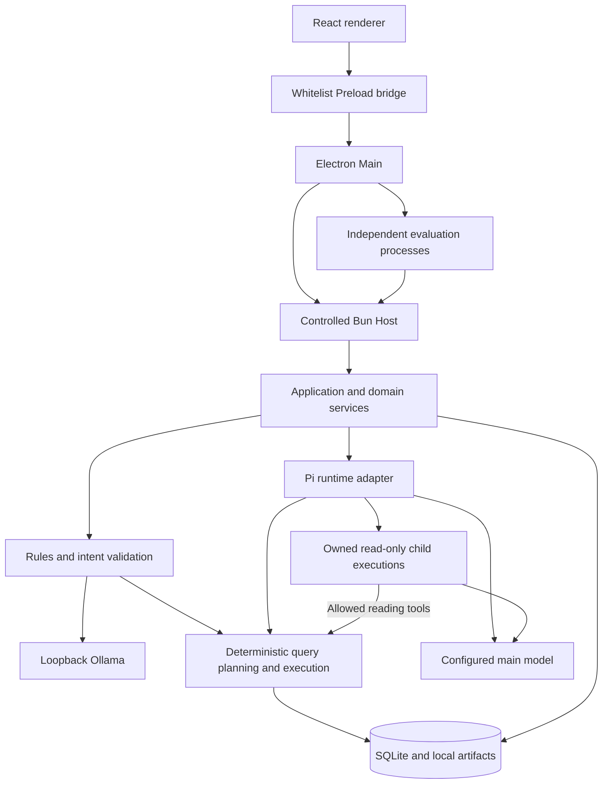

# System architecture

[简体中文](overview.zh-CN.md) · [Documentation index](../README.md)

MedClaw separates the desktop surface, process and credential ownership, business execution, and model integration. The principal boundaries are:

## Responsibilities

| Component | Responsibility | Source |
| --- | --- | --- |
| Desktop | Main owns process control and credentials; Preload exposes approved methods; React projects state | [Desktop sources](../../apps/desktop/src) |
| Host | Business initialization, database ownership, controlled communication and maintenance entrypoints | [Host sources](../../apps/host/src) |
| Contracts | Zod schemas, method contracts, events, model and runtime configuration | [Contracts](../../packages/contracts/src) |
| Core | Application coordination, sessions, scope, intent, resources, queries and exports | [Core](../../packages/core/src) |
| Pi integration | Agent execution, native history, tool adaptation and compaction integration | [Runtime adapter](../../packages/runtime-pi/src) |
| Local intent client | Ollama inspection and structured classification/review requests | [Ollama adapter](../../packages/intent-ollama/src/index.ts) |
| Storage and logging | SQLite repositories and migrations; bounded diagnostics and safe projections | [Storage](../../packages/storage/src), [logging](../../packages/logging/src) |
| Evaluation | Independent execution, observations, scorers, reports and platform adapters | [Evaluation sources](../../agent-eval/src) |

## Request and evidence flow

An admitted input captures its data scope, configuration and reference time. Core coordinates either main-Agent execution or the [intent pipeline](../intent/overview.md). Tool boundaries enforce permissions and input/output contracts; query services compute results and persist Query and Evidence identities. The renderer displays the resulting state and can read saved originals through approved methods.

Context selection, resource discovery, actual reads, delivery to a model, and adoption in an answer are separate observations. Native session persistence and compaction add their own completion facts. Streaming text alone does not prove the corresponding database transaction or final delivery completed.

## Intent and Agent roles

The intent model is configured independently of the main Agent. Rules may resolve an input without a model request; other inputs use structured classification and at most one requested review. Validation checks actual entities, explicit constraints, coverage and capabilities before routing. Current policy can compile supported single or dependent tasks into program query steps. See [intent recognition](../intent/overview.md) for statuses and configuration.

The main Agent uses Pi for the Agent Loop, model access, native tools, history and resources. Product code adds scope, budgets, cancellation, business tools and persistence checks. Neither a Skill instruction nor a model-proposed call expands an admitted permission.

## Delegation and captured resources

The Host supplies built-in and user role sources to `Application`. Input admission captures the available role bodies and resource versions, then the Pi adapter binds an actual parent `Agent` ToolCall to a child identity before child execution. Children have independent native histories and read-only tool subsets. At most four child executions can remain owned, sharing the root budget and deadline. A result-save or release gap keeps ownership occupied. See [subagents](../agents/subagents.md) for management, cancellation and evidence checks.

Prompt optimization uses a separate Provider Run. **Use in chat** only inserts the resulting text into a confirmed draft. Skills, versioned prompt templates, role files and extension commands retain distinct contracts; configuration-preview readiness and the accepted Run's tool scope also have distinct meanings. Later edits do not rewrite captured Run resources. See [Prompt and Skills](../guides/prompts-and-skills.md).

## Ownership and failure boundaries

The renderer has no general filesystem, SQL or process interface. Main handles credential entry and controlled Host lifetime; the Host owns business writes. Shutdown distinguishes execution stopped, necessary persistence, database closure and process-tree completion. Unknown outcomes remain unknown. Backup and restore use maintenance operations after the necessary shutdown checks; see [Windows maintenance](../release/windows-packaging.md).

See [public behavior contracts](behavior-contracts.md) for the stable source sections used by dataset authoring checks. These documents explain current behavior without requiring local planning materials.
