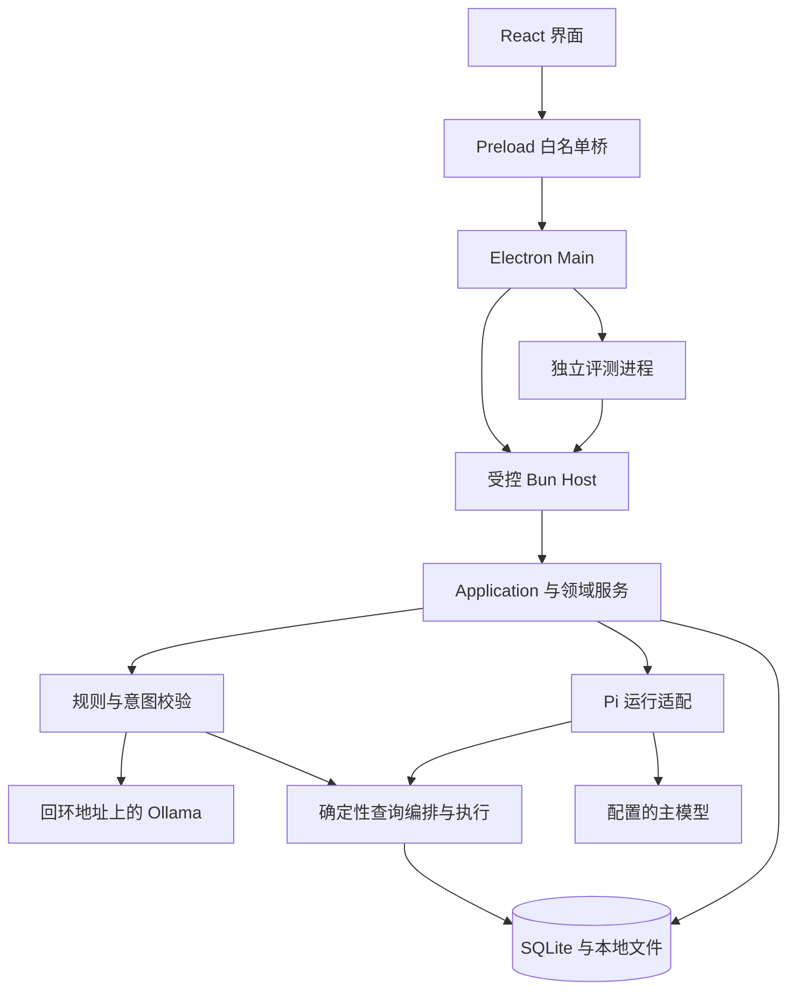

# 系统架构

[English](overview.md) · [文档目录](../README.md)

MedClaw 将桌面界面、进程与凭据所有权、业务执行和模型接入分开。主要边界如下：

## 职责划分

| 组件 | 职责 | 源码 |
| --- | --- | --- |
| 桌面 | Main 管理进程与凭据；Preload 暴露获准方法；React 投影状态 | [桌面源码](../../apps/desktop/src) |
| Host | 业务初始化、数据库所有权、受控通信与维护入口 | [Host 源码](../../apps/host/src) |
| 契约 | Zod 校验、方法契约、事件、模型与运行配置 | [契约](../../packages/contracts/src) |
| Core | 应用协调、会话、范围、意图、资源、查询与导出 | [核心服务](../../packages/core/src) |
| Pi 接入 | Agent 执行、原生历史、工具适配与上下文压缩 | [运行适配](../../packages/runtime-pi/src) |
| 本地意图客户端 | Ollama 核验及结构化分类、复核请求 | [Ollama 适配](../../packages/intent-ollama/src/index.ts) |
| 存储与日志 | SQLite 仓储与迁移；有界诊断和安全投影 | [存储](../../packages/storage/src)、[日志](../../packages/logging/src) |
| 评测 | 独立执行、观测、评分、报告与平台适配 | [评测源码](../../agent-eval/src) |

## 请求与依据流

输入获准执行时记录数据范围、配置和参考时间。Core 协调主 Agent 或[意图识别链路](../intent/overview.zh-CN.md)。工具边界检查权限和输入输出契约，查询服务计算结果并保存 Query、Evidence 身份。界面展示结果状态，并通过获准方法读取原件。

上下文选择、资源发现、实际读取、模型请求交付和回答采用是不同事实。原生会话持久化和压缩也有各自的完成事实。界面显示流式文本，不能单独证明数据库事务或最终交付已经完成。

## 意图与 Agent 的分工

意图模型与主 Agent 分别配置。规则可以在不调用模型的情况下解决请求；其他请求经过结构化分类，必要时最多复核一次。路由前，程序检查真实实体、明确条件、数据覆盖与实际能力。当前策略可把受支持的单项或有依赖任务编译为程序查询步骤。状态与配置见[意图识别](../intent/overview.zh-CN.md)。

主 Agent 使用 Pi 的 Agent Loop、模型访问、原生工具、历史和资源能力。产品代码增加范围、预算、取消、业务工具和保存检查。Skill 指令和模型提出的调用都不能扩大已获准权限。

## 所有权与失败边界

界面没有通用文件系统、SQL 或进程接口。Main 处理凭据输入和受控 Host 生命周期，Host 承担业务写入。退出时分别确认执行停止、必要保存、数据库关闭和进程树停止；无法确认的结果保留未知。备份与恢复通过必要停写检查后的维护操作完成，见[Windows 维护](../release/windows-packaging.zh-CN.md)。

[公开行为契约](behavior-contracts.zh-CN.md)提供数据集制作核验使用的稳定章节。这些文档说明当前行为，不依赖本地计划资料。
