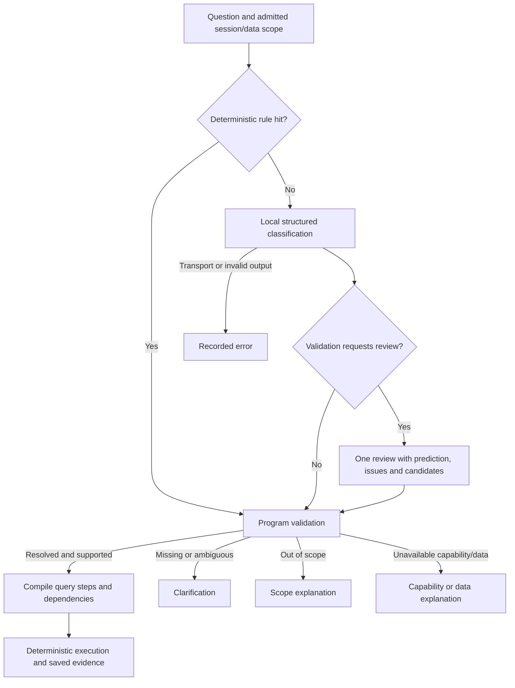

# Intent recognition and routing

[简体中文](overview.zh-CN.md) · [Configuration](configuration.md) · [Documentation index](../README.md)

Intent recognition converts a question and its admitted context into a checked task. The local intent model is separate from the main Agent model. Selecting **Intent routing** in Chat uses this product path; selecting **Main Agent** uses the normal Agent path.

## Pipeline

[IntentService](../../packages/core/src/intent/intent-service.ts) evaluates rules before admitting a model call. A rule hit still passes program validation. The model path inspects the local model, records input context and call identity, performs classification, and requests at most one review when validation explicitly requires it. Review carries the original prediction or preview, validation issues, finite candidates and the previous call identity. It is not an unrestricted retry loop.

Missing parameters, unsupported capabilities and truncated output do not trigger semantic review. Transport errors remain errors. A final invalid result must not become a fabricated `RESOLVED` task. Calls, validation and route decisions retain their own saved facts.

## Recognition contract

The current result contract is `medclaw.intent/v2`; see [intent schemas](../../packages/contracts/src/intent.ts).

| Field or constraint | Meaning |
| --- | --- |
| `l0`, `l1`, `l2` | Domain, task family and concrete operation; the hierarchy must match the taxonomy |
| `slots` | Time, region, device, manufacturer, category, status, change, metric and grouping constraints |
| `parameters` | Operation-specific fields such as comparison objects or an anomaly method |
| `dependsOn`, `resultRef` | Dependencies must reference earlier declared steps; a result reference must agree with dependencies |
| `candidateIntents`, `clarification` | Finite ambiguity candidates and explicit missing-condition questions |
| Limits | At most eight task steps; time ranges use `[start, endExclusive)` and span at most 366 days |

Labels are declared in `INTENT_TAXONOMY`. Actual admission is governed by the [capability map](../../packages/core/src/intent/taxonomy.ts), available data, adapters and scope. For example, search, supported changes, category/region aggregation, price trends and supported comparisons are conditional capabilities. Certificate queries, arbitrary missing-field/duplicate audits, formal monitoring reports and automatic result-export intents are currently disabled. Device status is not certificate status. A registered `EXPORT_RESULT` label does not enable the page's separate export operation through intent routing.

## Semantic results and failures

| Status | Meaning and handling |
| --- | --- |
| `RESOLVED` | A task is determined; validation and the actual capability still control execution |
| `NEED_PARAMETERS` | The task is determined but required conditions are missing; ask for those conditions |
| `AMBIGUOUS` | Several finite interpretations remain; preserve candidates and ask a question |
| `OUT_OF_SCOPE` | The request is outside the supported domain; return a scope explanation |
| `UNSUPPORTED_DATA` | The recognized task lacks a supported capability or required data; explain the limitation |

Invalid structured output, identity mismatch, network failure and cancellation are execution facts rather than extra semantic statuses. The [routing policy](../../packages/core/src/intent/route-policy.ts) refuses invalid or still-reviewable validation. Under current policy, supported resolved tasks can become a program execution plan, including multiple queries and dependencies. Query results preserve adopted conditions, dates and evidence identities.

## Follow-ups and explicit conditions

The [validator](../../packages/core/src/intent/validate.ts) grounds entities and constraints in the admitted data scope. Explicit user corrections must be retained. Prior context can be inherited only through a valid adopted context; multiple unresolved query objects must not silently produce one chosen scope. Delivery-only tasks must not replace the business query context.

For “show the same device for a shorter date range”, identify the inherited device and the explicitly changed period. For “only active devices”, apply the explicit status without inventing unrelated filters. An unresolved device, region, date or comparison basis requires clarification or a capability/data explanation.

## Evaluation and current limits

Check classification, slots, clarification, actual routing and final deterministic facts separately. Existing evaluation cases include resolved and ambiguous intent requests; they do not prove broad language coverage. In particular, metadata inspection and engineering fixtures do not establish semantic accuracy for the fixed 0.8B model.

See [intent evaluation](../evaluation/overview.md#intent-recognition-evaluation), [configuration and troubleshooting](configuration.md), and [public behavior contracts](../architecture/behavior-contracts.md#intent-recognition-and-routing). No accuracy percentage or completed real-model acceptance is implied by this documentation.
