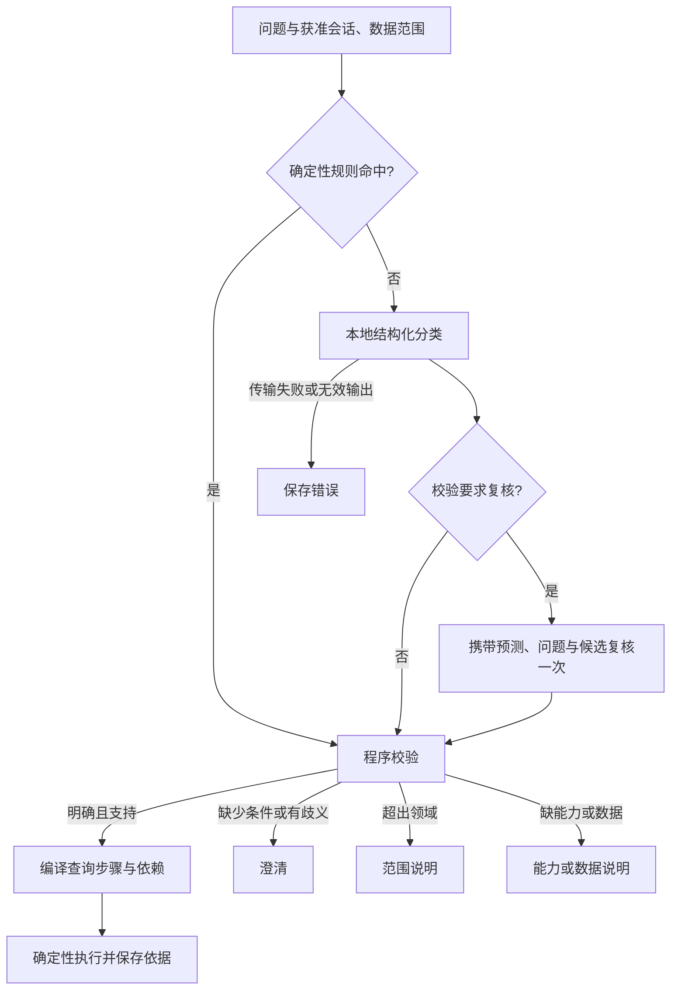

# 意图识别与路由

[English](overview.md) · [配置说明](configuration.zh-CN.md) · [文档目录](../README.md)

意图识别把问题和实际采用的上下文转为经过检查的任务。本地意图模型与主 Agent 模型独立配置。Chat 中选择 **Intent routing** 使用这一产品链路，选择 **Main Agent** 使用常规 Agent 路径。

## 完整流程

[IntentService](../../packages/core/src/intent/intent-service.ts) 在模型调用获准前执行规则，规则命中仍需程序校验。模型路径核验本地模型、记录输入上下文和调用身份，再执行分类；只有校验明确要求时才最多复核一次。复核携带原预测或预览、校验问题、有限候选和上一次调用身份，不是无限重试循环。

缺参数、能力不支持和截断输出不会触发语义复核。传输失败仍为错误，最终无效结果不能变成虚构的 `RESOLVED` 任务。调用、校验与路由决定各自保留保存事实。

## 识别契约

当前结果契约是 `medclaw.intent/v2`，见[意图 Schema](../../packages/contracts/src/intent.ts)。

| 字段或约束 | 含义 |
| --- | --- |
| `l0`、`l1`、`l2` | 领域、任务类别与具体操作，层级关系须匹配分类表 |
| `slots` | 时间、地区、器械、企业、类别、状态、变化、统计指标与分组条件 |
| `parameters` | 比较对象、异常方法等操作专属参数 |
| `dependsOn`、`resultRef` | 依赖只能指向已声明的前置步骤，结果引用须与依赖一致 |
| `candidateIntents`、`clarification` | 有限歧义候选，以及明确指出缺少条件的问题 |
| 上限 | 最多八个任务步骤；时间采用 `[start, endExclusive)`，范围最多 366 天 |

`INTENT_TAXONOMY` 声明标签，实际执行还受[能力表](../../packages/core/src/intent/taxonomy.ts)、数据、适配器与范围约束。例如搜索、受支持的变化、类别与地区统计、价格趋势和受支持的比较均有执行前提。证书查询、任意缺字段或重复审计、正式监测报告和自动结果导出意图目前禁用。器械状态不等于证书状态，注册 `EXPORT_RESULT` 标签也不代表意图路由能调用页面中的独立导出操作。

## 语义结果与执行失败

| 状态 | 含义与处理 |
| --- | --- |
| `RESOLVED` | 任务已确定，但执行仍由校验与实际能力决定 |
| `NEED_PARAMETERS` | 任务已确定，必要条件缺失，询问对应条件 |
| `AMBIGUOUS` | 有限解释尚未消歧，保留候选并澄清 |
| `OUT_OF_SCOPE` | 超出支持领域，说明适用范围 |
| `UNSUPPORTED_DATA` | 已识别任务缺少能力或必要数据，说明限制 |

无效结构输出、身份不匹配、网络失败和取消属于执行事实，不是额外语义状态。[路由策略](../../packages/core/src/intent/route-policy.ts)拒绝无效或仍待复核的校验结果。当前策略可将受支持的明确任务转为程序执行计划，包含多查询和依赖；结果保留实际采用条件、日期与依据身份。

## 主 Agent 辅助与明确委派

获准意图任务采用主 Agent 路由时，父任务可以使用[只读子代理](../agents/subagents.zh-CN.md)独立分析。经过校验的查询步骤和最终 Answer 仍属于父任务，子任务指令与输出不能替换已接受的意图参数、QueryContext 或授权。

明确的 `/subagent`、`/medclaw-evidence-review` 和 `/parallel-medclaw-review` 输入使用委派路径，不经过本地意图分类。它们需要新的 Send 和对应可用角色，命令或模板来源与实际子调用分别核查。参见[输入类型](../guides/prompts-and-skills.zh-CN.md#选择输入类型)。

## 追问与明确条件

[校验器](../../packages/core/src/intent/validate.ts)在获准数据范围中核对实体和约束。用户明确纠正的条件必须保留，只能通过有效的采用上下文继承历史；多个未解决查询对象不能静默变成一个选择范围，交付类任务也不能替换业务查询上下文。

“还是这个器械，把时间缩短”需要核对继承器械与明确新期间；“只看在售”应采用用户明确状态，而不增加无关筛选。器械、地区、日期或比较口径仍不明时，应澄清或说明能力、数据限制。

## 评测与当前限制

分类、参数、澄清、实际路由和最终确定性结果分别核验。现有评测包含明确意图与歧义请求，不证明已覆盖所有自然语言表达；固定 0.8B 模型的元信息核验和工程夹具也不证明语义准确率。

参见[意图识别评测](../evaluation/overview.zh-CN.md#意图识别评测)、[配置与排查](configuration.zh-CN.md)、[公开行为契约](../architecture/behavior-contracts.zh-CN.md#意图识别与路由)。本页不提供未实测的准确率，也不声称真实模型验收已经完成。
